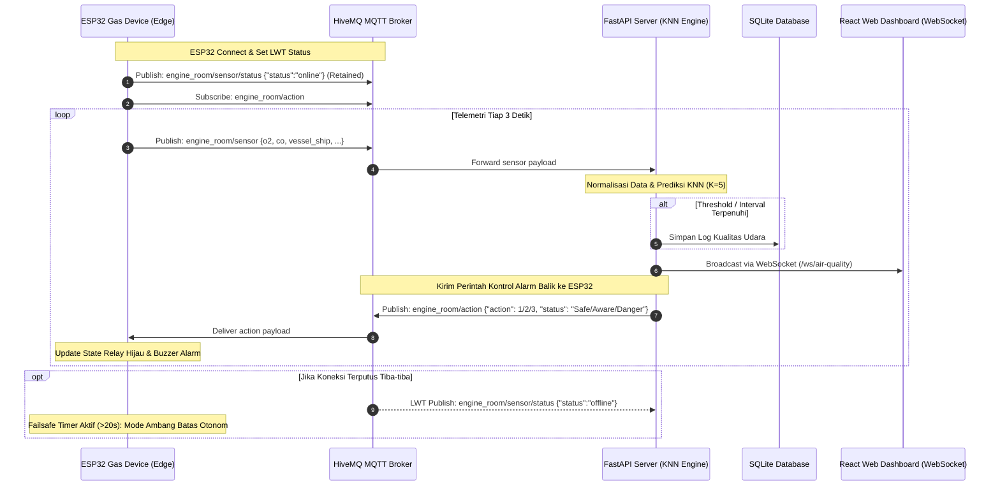

# Dokumentasi Protokol MQTT: Sistem Klasifikasi Kualitas Udara Engine Room Kapal

Dokumentasi ini menjelaskan secara komprehensif arsitektur komunikasi, konfigurasi broker, struktur topik, skema payload, dan mekanisme kontrol alarm berbasis protokol **MQTT (Message Queuing Telemetry Transport)** pada sistem pemantauan ruang terbatas (*confined space / engine room*) kapal.

---

## 1. Arsitektur Komunikasi Sistem

Sistem ini menerapkan siklus umpan balik tertutup (*closed-loop AIoT system*) di mana mikrokontroler ESP32 mengirimkan telemetri sensor gas, backend FastAPI memproses klasifikasi berbasis *Machine Learning* (K-Nearest Neighbor), lalu mengirimkan instruksi aksi kontrol (*action alarm*) kembali ke ESP32 untuk menggerakkan aktuator fisik (LED dan Buzzer).



---

## 2. Konfigurasi Broker MQTT

Sistem dapat menggunakan broker publik HiveMQ (untuk pengujian) atau HiveMQ Cloud terenkripsi TLS (untuk lingkungan produksi).

| Parameter | Nilai Default (Pengembangan) | Nilai Produksi (HiveMQ Cloud) | Keterangan |
| :--- | :--- | :--- | :--- |
| **Broker Host** | `broker.hivemq.com` | `[cluster-id].hivemq.cloud` | Host server MQTT |
| **Port** | `1883` | `8883` (SSL/TLS) | Port koneksi TCP |
| **Transport** | TCP murni | TLS / SSL (v1.2/v1.3) | Protokol enkripsi paket |
| **MQTT Version** | 3.1.1 | 3.1.1 | Standar protokol |
| **Autentikasi** | *Kosong (Anonim)* | Username & Password | Kredensial akun HiveMQ |
| **KeepAlive** | 60 detik | 60 detik | Detak jantung koneksi |
| **Client ID ESP32** | `esp32-engine-room-01` | `esp32-engine-room-01` | Harus unik per perangkat |
| **Client ID Backend** | Otomatis generate unik | Otomatis generate unik | Client ID consumer server |

> [!NOTE]
> Konfigurasi pada backend diatur melalui file [backend/.env](file:///c:/Users/Victus/Documents/AIoT-Klasifikasi-Udara/backend/.env), sedangkan konfigurasi pada ESP32 diatur langsung pada baris deklarasi di [esp32-gas-device.ino](file:///c:/Users/Victus/Documents/AIoT-Klasifikasi-Udara/arduino-code/esp32-gas-device/esp32-gas-device.ino).

---

## 3. Daftar Topik MQTT

Terdapat 3 topik utama yang digunakan dalam ekosistem ini:

| Topik | Tipe | Publisher | Subscriber | Fungsi |
| :--- | :--- | :--- | :--- | :--- |
| `engine_room/sensor` | Telemetri | ESP32 / Simulator | Backend FastAPI | Mengirim pembacaan sensor O₂ dan CO secara berkala (tiap 3 detik) |
| `engine_room/sensor/status` | LWT / Status | ESP32 / Simulator / Broker | Backend FastAPI | Melaporkan status hidup (*online*) atau mati (*offline*) perangkat |
| `engine_room/action` | Kontrol / Aksi | Backend / Penguji | ESP32 Hardware | Mengirim instruksi level alarm (Safe, Warning, Danger) ke ESP32 |

---

## 4. Spesifikasi Topik & Skema Payload

### 4.1. Topik `engine_room/sensor` (Telemetri Data)

Topik ini digunakan untuk mempublikasikan pembacaan data fisik dari sensor gas di ruang mesin kapal.

- **Publisher**: ESP32 Firmware / Python Simulator
- **QoS**: 0 atau 1
- **Retain**: `false`
- **Frekuensi**: Setiap 3 detik

#### Struktur JSON Payload:
```json
{
  "vessel_ship": "SIMULATED_VESSEL_01",
  "location_work": "ENGINE_PUMP_ROOM",
  "o2": 20.95,
  "co": 1.25,
  "alarm": 1,
  "alarm_status": "SAFE",
  "timestamp": "2026-10-14T07:15:30Z"
}
```

#### Deskripsi Field:
| Field | Tipe Data | Satuan / Format | Deskripsi |
| :--- | :--- | :--- | :--- |
| `vessel_ship` | `string` | Teks | Nama kapal tempat perangkat terpasang |
| `location_work` | `string` | Teks | Titik kompartemen / lokasi kerja (*confined space*) |
| `o2` | `float` | `%vol` (Persen Volume) | Kadar konsentrasi Oksigen (O₂) |
| `co` | `float` | `ppm` (Parts Per Million) | Kadar konsentrasi Karbon Monoksida (CO) |
| `alarm` | `integer` | 0 - 3 | Level alarm saat ini di ESP32 (0: None, 1: Safe, 2: Warning, 3: Danger) |
| `alarm_status` | `string` | `"SAFE"`, dll. | Label status alarm di ESP32 |
| `timestamp` | `string` | ISO 8601 UTC (`YYYY-MM-DDTHH:MM:SSZ`) | Waktu perekaman tersinkronisasi NTP |

---

### 4.2. Topik `engine_room/sensor/status` (Lifecycle & LWT)

Topik ini memanfaatkan fitur **Last Will and Testament (LWT)** bawaan MQTT untuk memastikan status koneksi perangkat dapat dideteksi secara akurat oleh backend, bahkan jika perangkat mati mendadak (kehilangan daya atau koneksi putus tiba-tiba).

- **Publisher**: ESP32 (saat connect & saat graceful shutdown) dan MQTT Broker (saat koneksi putus mendadak via LWT)
- **QoS**: 1
- **Retain**: `true` (memastikan subscriber yang baru connect langsung mengetahui status terakhir)

#### Contoh Payload Online (Saat ESP32 Terhubung):
```json
{
  "status": "online"
}
```

#### Contoh Payload Offline (Dipublikasikan Otomatis oleh Broker jika ESP32 Terputus):
```json
{
  "status": "offline"
}
```

---

### 4.3. Topik `engine_room/action` (Kontrol Alarm ESP32)

Topik ini digunakan oleh backend (atau operator dari luar) untuk mengirim perintah langsung ke ESP32 agar menyalakan indikator visual dan auditori sesuai hasil klasifikasi AI.

- **Publisher**: Backend FastAPI (setelah evaluasi KNN) / Operator Penguji
- **Subscriber**: ESP32 Firmware
- **QoS**: 1
- **Retain**: `false`

#### Format Payload yang Didukung oleh ESP32 Firmware:
ESP32 telah dilengkapi parser fleksibel yang menerima berbagai format berikut:

1. **Format JSON Standar (Direkomendasikan)**:
   ```json
   {
     "action": 1,
     "status": "Safe",
     "timestamp": "2026-10-14T07:15:30Z"
   }
   ```
2. **Format JSON Alternatif**:
   - `{"alarm": 2}`
   - `{"knn_class": "Danger"}`
   - `{"status": "Aware"}`
3. **Format String Teks Polos**:
   - Berdasarkan Angka: `"1"`, `"2"`, `"3"`, `"0"`
   - Berdasarkan Nama Kelas: `"Safe"`, `"Aware"`, `"Warning"`, `"Danger"`, `"Off"`

#### Pemetaan Level Alarm & Respons Aktuator Perangkat:

| Level | Status Klasifikasi | Kondisi Gas (OSHA/IMO) | Relai Lampu Hijau (`RELAY_GREEN`) | Relai Buzzer (`RELAY_BUZZER`) |
| :---: | :--- | :--- | :--- | :--- |
| **0** | `NONE` / `OFF` | Perangkat Standby | **OFF** (Mati) | **OFF** (Mati) |
| **1** | `SAFE` (Aman) | O₂ $\ge 20.8\%$, CO $< 10\text{ ppm}$ | **ON** (Menyala Solid) | **OFF** (Senyap) |
| **2** | `WARNING` / `AWARE` (Waspada) | $19.5\% \le \text{O}_2 < 20.8\%$ atau $10 \le \text{CO} \le 25\text{ ppm}$ | **KEDIP** (500ms ON / 500ms OFF) | **BEEP INTERMITEN** (Beep 200ms tiap 2 detik) |
| **3** | `DANGER` (Bahaya) | $\text{O}_2 < 19.5\%$ atau $\text{CO} > 25\text{ ppm}$ | **OFF** (Mati) | **ON CONTINUOUS** (Bunyi terus-menerus / Sirine darurat) |

---

## 5. Mekanisme Keandalan & Keselamatan (*Safety Features*)

Dalam aplikasi keselamatan ruang mesin kapal (*marine safety*), kegagalan jaringan tidak boleh membahayakan nyawa kru kapal. Oleh karena itu, firmware ESP32 dilengkapi dengan lapisan pengamanan berikut:

### 5.1. Failsafe Watchdog Otonom (Mode Darurat Lokal)
- Jika ESP32 tidak menerima perintah pada topik `engine_room/action` selama lebih dari **20 detik** (`FAILSAFE_TIMEOUT_MS = 20000`), mikrokontroler secara otonom mengaktifkan evaluasi ambang batas lokal (*rule-based fallback*).
- Dengan demikian, jika koneksi internet atau server backend mengalami kendala, alarm tetap akan berbunyi seketika jika sensor mendeteksi gas berbahaya ($\text{O}_2 < 19.5\%$ atau $\text{CO} > 25\text{ ppm}$).
- Begitu koneksi pulih dan backend mengirim aksi baru, kontrol kembali sepenuhnya ke sistem AI/KNN backend.

### 5.2. Konfigurasi Polaritas Relai (`RELAY_ACTIVE_LOW`)
Sebagian besar modul relai komersial 5V untuk Arduino/ESP32 bekerja dengan logika **Active-LOW** (sinyal LOW menyalakan relai, sinyal HIGH mematikan relai). Firmware menyediakan konstanta konfigurasi pada [const_pin.h](file:///c:/Users/Victus/Documents/AIoT-Klasifikasi-Udara/arduino-code/esp32-gas-device/const_pin.h):
```cpp
// Set 0 jika relai Active-HIGH, set 1 jika modul relai Active-LOW
#define RELAY_ACTIVE_LOW 0
```
Hal ini memastikan aktuator tidak terbalik logika tanpa perlu mengubah kode `digitalWrite` di seluruh program.

### 5.3. Proteksi Interferensi Elektromagnetik (EMI) Tombol Reset
Penyalaan beban induktif tinggi (kumparan relai atau sirine mekanis) sering menimbulkan lonjakan tegangan transien (*inductive kick*) pada jalur ground yang dapat memicu false restart pada pin GPIO.
Firmware menerapkan verifikasi tombol tahan selama **1.5 detik** sebelum mikrokontroler mengeksekusi `ESP.restart()`.

---

## 6. Panduan Pengujian & Simulasi MQTT

### 6.1. Pengujian Menggunakan CLI (`mosquitto_sub` & `mosquitto_pub`)

#### A. Memantau Telemetri Sensor:
```bash
mosquitto_sub -h broker.hivemq.com -p 1883 -t "engine_room/sensor" -v
```

#### B. Memantau Status Online/Offline (LWT):
```bash
mosquitto_sub -h broker.hivemq.com -p 1883 -t "engine_room/sensor/status" -v
```

#### C. Menguji Perintah Alarm ke ESP32:
- **Set Status Aman (Safe)**:
  ```bash
  mosquitto_pub -h broker.hivemq.com -p 1883 -t "engine_room/action" -m '{"action": 1, "status": "Safe"}'
  ```
- **Set Status Waspada (Warning)**:
  ```bash
  mosquitto_pub -h broker.hivemq.com -p 1883 -t "engine_room/action" -m '{"action": 2, "status": "Aware"}'
  ```
- **Set Status Bahaya (Danger)**:
  ```bash
  mosquitto_pub -h broker.hivemq.com -p 1883 -t "engine_room/action" -m '{"action": 3, "status": "Danger"}'
  ```

---

### 6.2. Pengujian Menggunakan GUI (MQTT Explorer)
1. Unduh dan buka aplikasi **MQTT Explorer** (https://mqtt-explorer.com/).
2. Masukkan Host: `broker.hivemq.com`, Port: `1883`.
3. Klik **Connect**.
4. Pada panel sebelah kiri, cari topik `engine_room`:
   - Amati update data realtime pada `engine_room/sensor`.
   - Amati pesan retain pada `engine_room/sensor/status`.
5. Untuk menguji aktuasi ESP32:
   - Pada panel Publish di sebelah kanan bawah, masukkan topik: `engine_room/action`.
   - Pilih format: `raw` atau `json`.
   - Masukkan payload: `{"action": 3, "status": "Danger"}` lalu klik **Publish**.
   - Perhatikan bahwa lampu hijau pada ESP32 mati dan relai buzzer berbunyi seketika.

---

### 6.3. Menjalankan IoT Simulator Python
Untuk menguji aliran end-to-end tanpa perangkat keras ESP32 fisik:
```powershell
# Masuk ke direktori backend
cd backend

# Jalankan simulator mode acak (dummy)
python src/simulator.py dummy

# Atau jalankan simulator berdasarkan data riil dataset Excel
python src/simulator.py dataset
```
Backend FastAPI yang sedang berjalan akan otomatis menerima data dari simulator, melakukan prediksi KNN, menyimpan riwayat ke SQLite, membroadcast ke web dashboard, dan menerbitkan tindakan (*action*) ke topik `engine_room/action`.
